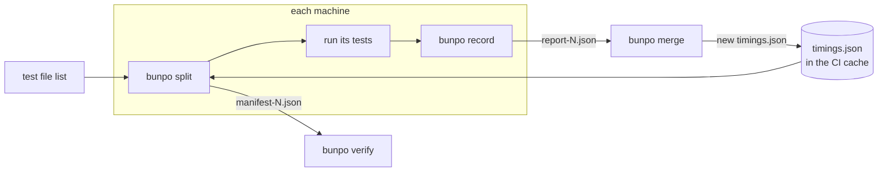
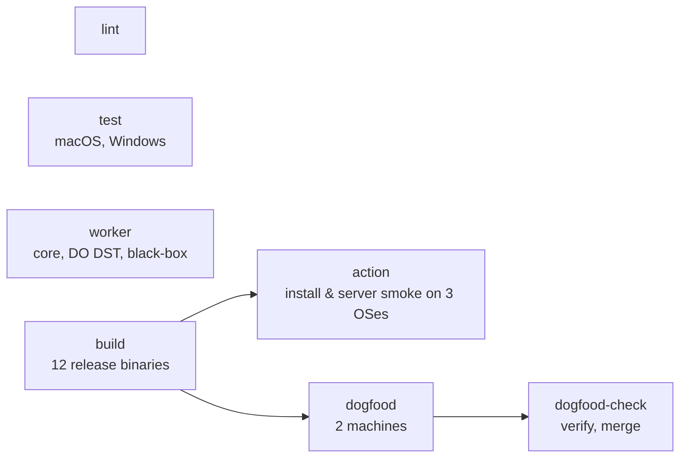
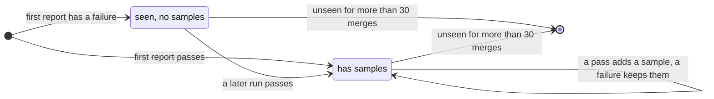
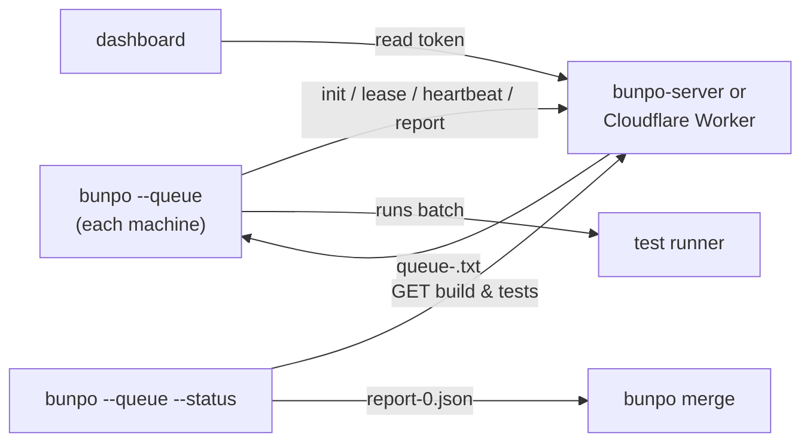

# The Bunpō book

This book describes the code as it is today. [PROJECT.md](../PROJECT.md) holds
the plan and the specification. Update the book whenever a change alters
behavior, architecture, setup or operation.

## Status

Both static mode (`split`, `plan`, `record`, `merge`, `verify`) and the
self-hosted live queue (`--queue`, `--status`, `bunpo-server`, the Cloudflare
Worker in `worker/`, and the shared dashboard) are implemented. A tag builds
release binaries for `bunpo` and `bunpo-server`, `action.yml` installs `bunpo`
in GitHub Actions, and [guides](guides/) cover pytest, Jest, Vitest, RSpec and
Playwright. Bunpō's own CI splits its tests through all of it, and an external
GitHub Actions trial ran from the Playwright guide alone
([docs/trials/2026-11-22-souhib-github-actions-trial.md](trials/2026-11-22-souhib-github-actions-trial.md)).
The website is live at [bunpo.org](https://bunpo.org).

## How it fits in CI



The [guides](guides/) give a complete GitHub Actions workflow per runner. The
core of one run, on eight machines, looks like this:

```bash
# On machine N, with timings.json restored into .bunpo/
set -euo pipefail
find tests \( -name 'test_*.py' -o -name '*_test.py' \) | bunpo split --index "$N" --total 8 > mine.txt

# One path per array item, so spaces and glob characters stay literal.
mine=()
while IFS= read -r path; do mine+=("$path"); done < mine.txt

# Given no files, most runners run the whole suite, so an empty share must
# skip the test command.
if [ "${#mine[@]}" -gt 0 ]; then
  pytest --rootdir=. -o junit_family=xunit1 --junitxml=junit.xml -- "${mine[@]}"
  bunpo record --index "$N" junit.xml
else
  bunpo record --index "$N"
fi
# Upload .bunpo/ as an artifact.

# In a final job, with every machine's .bunpo/ downloaded into one empty folder
find tests \( -name 'test_*.py' -o -name '*_test.py' \) | bunpo verify
bunpo merge   # on the main branch only; then save .bunpo/timings.json
```

The loop works in the bash 3.2 that macOS ships, which has no `mapfile`.

## Development setup

Install Go 1.21 or later. The `toolchain` line in `go.mod` (currently
`go1.27.4`) makes Go download the exact version on first use. Staticcheck and
`govulncheck` are `tool` directives in `go.mod`, so there is nothing else to
install.

```sh
gofmt -l .                     # must print nothing
go mod tidy -diff              # must print nothing
go vet ./...
go tool staticcheck ./...
go test -race ./...
go tool govulncheck ./...
go build -o bin/bunpo ./cmd/bunpo
go build -o bin/bunpo-server ./cmd/bunpo-server
```

For the Cloudflare Worker (`worker/`), install pinned dev dependencies with
lifecycle scripts disabled and run typecheck, pure core tests, Durable Object
lifecycle/eviction tests, and the local `workerd` black-box suite:

```sh
(cd worker && npm ci --ignore-scripts && npm run typecheck && npm run test:core && npm run test:do)
./worker/scripts/test-blackbox.sh
```

Fuzzing and the benchmark run only when you ask for them:

```sh
go test -run '^$' -fuzz FuzzDecode -fuzztime 30s ./internal/timing
go test -run '^$' -fuzz FuzzRead -fuzztime 30s ./internal/junit
go test -run '^$' -fuzz FuzzEventReplay -fuzztime 30s ./internal/queue
go test -run '^$' -bench BenchmarkSplit ./internal/split
```

The golden JUnit reports in `internal/junit/testdata/` come from the real
runners. To regenerate them after changing a sample suite or a pinned version,
run the script, refresh the expected totals, and review the diff:

```sh
internal/junit/testdata/generate.sh   # needs python3, node and ruby
go test ./internal/junit -update
```

The script runs every suite from `/tmp/bunpo-fixtures`, so absolute paths in
the reports never contain a home directory, and it scrubs host names and
time zones. `.gitattributes` forces LF line endings, because golden files are
compared byte for byte.

Two separate programs check the parts unit tests cannot. Both need the
runners `generate.sh` installs:

```sh
go build -o bin/bunpo ./cmd/bunpo
go run ./benchmark -bunpo bin/bunpo -out docs/benchmark.md
go run ./guidecheck -bunpo bin/bunpo
```

`guidecheck` runs the shell steps of every guide against the real runners,
with `bash -eo pipefail` as a GitHub `shell: bash` step does, in four
scenarios: two machines, decoy files (a path that contains an assigned path,
and a name with glob characters), a failed discovery command, and empty
shards. It checks each machine's exit status, that `record` reported exactly
the assigned files (with none missing or added), and that `verify` and `merge`
pass or fail as they should. It
also refuses a guide whose workflow does not set `shell: bash`. Run it after
changing a guide or a runner version.

To regenerate the README terminal recording (`docs/demo.gif`) after CLI output
changes, build `bin/bunpo` and run Charm's [VHS](https://github.com/charmbracelet/vhs):

```sh
go build -o bin/bunpo ./cmd/bunpo
PATH="$PWD/bin:$PATH" vhs docs/demo.tape
```

## Continuous integration

CI (`.github/workflows/ci.yml`) runs on every push to `shrek` and on every
pull request:



- **lint** runs `gofmt`, `go mod tidy -diff`, vet, Staticcheck and
  `govulncheck`.
- **test** runs the tests on macOS and Windows. Windows skips the race
  detector because its runner has no cgo.
- **worker** installs `worker/` dev dependencies with `--ignore-scripts` and
  runs TypeScript typecheck, shared vector and dashboard tests (`test:core`),
  500-seed plus hostile Go-to-Worker differential replay, Durable Object
  lifecycle and 200-seed eviction tests (`test:do`), and
  `worker/scripts/test-blackbox.sh` against local `workerd`.
- **build** runs `scripts/build-release.sh`, the same 12-binary build a tag runs.
- **action** installs `bunpo` through `action.yml` on Linux, macOS and
  Windows (checking `bunpo-server` is not installed by the Action) and runs
  `scripts/smoke-server.sh` against `bunpo-server` on all three OSes.
  `BUNPO_RELEASE_DIR` points the installer at the build instead of a release.
- **dogfood** is how Linux tests run: Bunpō splits its own test packages
  across two machines with `scripts/dogfood.sh`. Each Go package with tests
  is one file to Bunpō, named by its directory, and `go test -json` gives
  the times in the two-column format. `-count=1` keeps cached results, which
  report 0 ms, out of the timings. When a test fails, the script keeps the
  exit status, still records passing packages (and writes `-` for failed ones
  so they stay seen), and CI still uploads `.bunpo/`
  so `dogfood-check` can verify the split.
- **dogfood-check** verifies the assignment and merges the timings. Only
  passing pushes to `shrek` save them, so pull requests never change them and
  re-running a failed shard restores the same timings.

`.github/actions/go` sets up Go for the jobs that build: the toolchain from
`go.mod`, and Go build and module caches saved per commit and restored newest
first, so a run only rebuilds what changed. The lint job also caches
Staticcheck's results, which live outside the Go build cache. Actions are
pinned to commit SHAs, with the release named in a comment; bump the SHA and
the comment together.

## Releases

Pushing a tag such as `v0.0.3` runs `.github/workflows/release.yml`:

1. It runs the tests, then `scripts/build-release.sh` with `GOTOOLCHAIN` set to
   the exact toolchain in `go.mod`.
2. The script cross-compiles both `bunpo` and `bunpo-server` for Linux, macOS
   and Windows on x86-64 and ARM64 (12 binaries total) with cgo off and
   `-trimpath`, and writes `SHA256SUMS`. Two builds of one commit give the same
   bytes. Go stamps the version from the tag, and the script fails if any
   binary reports a different one, which catches a dirty or wrong checkout. It
   builds in a temporary directory first, because a new file in the checkout
   would mark every later binary dirty, and it refuses an output directory that
   is not empty rather than delete anything.
3. It publishes the binaries and `SHA256SUMS` as a prerelease first, so `@v0`
   and `releases/latest` never serve an unchecked binary.
4. It installs the published release through `action.yml` on Linux, macOS
   and Windows, checks that `bunpo version` reports the tag and that
   `bunpo-server` is not on `PATH`, then downloads `bunpo-server-<os>-<arch>`,
   verifies it against `SHA256SUMS`, and runs `scripts/smoke-server.sh`.
5. Only then does it promote a stable tag out of prerelease and move the major
   tag, `v0`, to the release, so `uses: nuggocto/bunpo@v0` follows the newest
   `v0.x.y` that installs everywhere. A prerelease such as `v0.0.3-rc.1` stays
   a prerelease and leaves `v0` where it is.

## The GitHub Action

`action.yml` only installs `bunpo`; workflows then call it in `run` steps,
because `split` and `verify` read the test list from standard input, which a
step input cannot carry. [Decision 2](decisions/0002-release-and-action.md)
explains the choice. `scripts/install.sh`:

- picks `bunpo-<os>-<arch>` for the runner, and fails with an annotation on
  an unsupported one;
- installs the release the action's ref names: `@v0.0.3` or `@v0.0.3-rc.1`
  installs exactly that release, and a major tag such as `@v0` the newest
  stable `v0.x.y` from the releases API (paginating up to 10 pages of 100
  releases), so a v1 never arrives under `@v0`.
  Any other ref, such as a branch or commit SHA, installs the latest release
  unless the `version` input pins a release tag;
- validates `version` and `releases/latest` redirects against a release-tag
  pattern (`vX.Y.Z`, with optional prerelease suffix) and major-tag API matches
  against a stable `vX.Y.Z` pattern before downloading; forwards `github.token`
  only when `github.server_url` is `https://github.com`;
- checks the binary against `SHA256SUMS` before putting it on `PATH`.

## Architecture

```text
action.yml               the GitHub Action: installs a release
Dockerfile               scratch container image for bunpo-server
benchmark/               the benchmark program behind docs/benchmark.md
guidecheck/              runs every guide's shell steps against the real runners
scripts/                 release build, Action installer, server smoke test, dogfooding
worker/                  Cloudflare Worker + SQLite Durable Objects queue server
cmd/bunpo/               the CLI: flags, files, messages, exit codes, --queue wrapper
cmd/bunpo-server/        standalone live-queue HTTP server (in memory or --data DIR) + dashboard
internal/dashboard/      embedded shared static live-queue dashboard (also served by worker/)
internal/split/          canonical identifiers, dealing, plan, digest
internal/timing/         timing file, median, merging, pruning
internal/junit/          reading JUnit XML and the two-column format
internal/manifest/       manifest, plan and run report files; the verify check
internal/jsonfile/       the strict versioned-JSON reader every file uses
internal/queue/          pure live-queue state machine (Decide/Apply) and shared vectors
internal/queueapi/       HTTP wire types, strict JSON handler, single-shot client, black-box suite
internal/queuerunner/    sans-I/O worker and status machines, thin OS driver, process-group signaling
internal/sim/            deterministic single-goroutine live-queue simulator and independent oracle
```

Only `cmd/bunpo`, `cmd/bunpo-server`, `internal/queueapi` (HTTP), and
`internal/queuerunner`'s thin driver (`driver.go`, `proc_unix.go`) touch I/O or
the operating system. The core packages (`split`, `timing`, `junit`, `manifest`,
`jsonfile`, `queue`) and `queuerunner`'s `Machine`/`StatusMachine` are plain
deterministic computations on bytes and values, so every platform gets the same
answer and the simulator drives the real code directly.

Imports flow one way:

```text
cmd/bunpo        ──▶ junit, manifest, queue, queueapi, queuerunner, split, timing
cmd/bunpo-server ──▶ dashboard, queue, queueapi
dashboard        ──▶ queue
queuerunner      ──▶ junit, manifest, queue, queueapi, timing
queueapi         ──▶ queue
manifest         ──▶ split, timing, jsonfile
queue            ──▶ split, timing
junit            ──▶ timing
split            ──▶ timing
timing           ──▶ jsonfile
```

## The commands

Every file lives in one directory, `.bunpo/` unless `--dir` says otherwise.
Commands open it as an `os.Root`, so no name inside it can escape through
`..` or a symlink.

| File | Written by | Read by |
| --- | --- | --- |
| `timings.json` | `merge` | `split`, `plan`, `merge`, `--queue` |
| `manifest-<index>.json` | `split` | `record`, `verify` |
| `report-<index>.json` | `record`, `--queue --status` (`report-0.json`) | `merge` |
| `plan.json` | `plan` | `split --plan` |
| `queue-<runner-id>.txt` | `--queue` | child test command (`BUNPO_TESTS_FILE`) |

Standard output carries only test lists. Messages go to standard error. Exit
status is 0 on success, 1 when a check fails, and 2 for bad usage or input.

Messages go through one `console` (`cmd/bunpo/console.go`):

- **In GitHub Actions** (`GITHUB_ACTIONS=true`), warnings, errors and the
  verify result become `::warning::`, `::error::` and `::notice::` workflow
  commands, so GitHub shows them on the run summary and the pull request.
  Newlines and percent signs are escaped so a multi-line message stays whole.
- **In a terminal**, the `warning:`, `error:` and `assignment verified:`
  labels are bold honey, rose and mint. Only the label is colored, so the
  message keeps the terminal's own text color. Each color has at least 3:1
  contrast on white and 4.5:1 on a dark background. Truecolor is used when
  `COLORTERM` says so, and a 256-color fallback otherwise.
- **Anywhere else** the output is plain: when `NO_COLOR` is set, when
  `TERM=dumb`, when standard error is a file or a pipe, and on the old
  Windows console, which prints escape codes as text.

Every file is written to a temporary name and renamed into place, so a
failed write leaves the previous file intact. Every member of every format,
nested entries included, is required: a missing `index` would otherwise read
as machine 0, and a missing `ms` in a run report would record 0 ms.

- **`split --index N --total M`** reads the test list from standard input,
  one path per line, LF or CRLF. On Windows it reads `\` as a separator. It
  splits with `timings.json` when there is one and prints machine N's share.
  Before anything else it deletes machine N's `manifest-N.json` and
  `report-N.json` from any earlier attempt, and it writes the new manifest
  only once the whole list is written. A failure anywhere therefore leaves no
  manifest for `verify` to accept. An empty test list is an error: a
  discovery command that found nothing would otherwise pass with no tests
  run. A carriage return counts only as part of CRLF; a lone one stays in the
  identifier, which then fails the identifier rules.
  The summary gives the range and average of predicted loads and the longest
  file, and warns about a dominant file and empty shards.
- **`plan --total M`** removes any leftover `plan.json`, splits once for every
  machine, and writes the new `plan.json`. **`split --index N --plan`** then
  takes machine N's share from the plan instead of standard input. Every
  manifest carries the plan's digest, so `verify` works the same either way.
- **`record --index N REPORT...`** removes any leftover `report-N.json` first,
  reads machine N's test reports (see below), and writes the new `report-N.json`.
  It needs this machine's manifest and validates `--path-prefix` upfront. With
  no reports it writes an empty run report, but only when the share was empty.
- **`merge`** reads every `report-*.json` in a fresh directory holding only the
  current run's reports and folds them into `timings.json`, then deletes those
  reports, so merging again in the same directory cannot count a run twice. A
  missing report fails with status 1 and leaves the timing file as it was,
  because a run with a machine missing has incomplete timings. So does a file
  that appears in two reports.
- **`verify`** reads the full test list from standard input and every
  `manifest-*.json`, and runs the verify check described below. On success it
  prints "assignment verified", and says that this covers what each machine
  was asked to run, not what ran.
- **`--queue URL --build ID [--index N] --total M --report PATH... [flags] < tests.txt -- command args...`**
  runs in live-queue worker mode. It reads `BUNPO_QUEUE_TOKEN` from the
  environment (never flags) and initializes or joins the build. It leases
  batches longest-first via guided self-scheduling and writes each batch to
  `.bunpo/queue-<runner-id>.txt` (exposed in `BUNPO_TESTS_FILE`). Before each batch
  it deletes old `--report` files, then runs the test command in its own Unix
  process group with queue tokens stripped from the environment. While the
  command runs it sends heartbeats at `TTL / 3` and reports outcomes until the
  build finishes. It exits 0 only on `passed`, 1 otherwise, and 2 on bad usage.
  Use `--allow-insecure-http` for plain `http://` on private networks outside
  loopback.
- **`--queue URL --build ID --status [--dir DIR]`** reads
  `BUNPO_QUEUE_READ_TOKEN` (falling back to `BUNPO_QUEUE_TOKEN`). It prints the
  verdict, counts, failed and unresolved tests, and any `init` conflicts. When
  the build finished with zero unresolved tests and zero conflicts, it writes
  `report-0.json` (`machines: 1`) so `bunpo merge` can update `timings.json`.
- **`bunpo-server [--addr 127.0.0.1:8080] [--data DIR]`** runs the standalone
  live-queue HTTP server. It requires distinct `BUNPO_QUEUE_TOKEN` and
  `BUNPO_QUEUE_READ_TOKEN` environment variables (each at least 16 bytes), logs
  structured JSON via `log/slog` without tokens, headers, or bodies, and shuts
  down cleanly on `SIGINT`/`SIGTERM`. Terminate TLS at your reverse proxy.
  Without `--data`, startup logs that builds live in memory only: a restart
  loses running builds, runners get `404` and exit `1`, and nothing passes
  across a restart. With `--data DIR`, `bunpo-server` binds `--addr` first,
  opens `DIR` (`0700`) through `os.Root`, loads existing build logs, and only
  then serves HTTP. Run at most one server per `--data` directory. Each build
  is stored in one `0600` file named by the lowercase hex SHA-256 of its build
  ID (`bunpo-queue-log 1\n`, then one `<crc32c> <json-array>\n` line per
  `Append`, bounded at `8 MiB`). Every `Append` checks the expected file size,
  writes, and `fsync`s before replying (`O_EXCL` plus directory `fsync` on
  create). On load, files with no complete record are removed, and an invalid
  last record at EOF is logged, truncated, and `fsync`ed as a torn write. Any
  read error, bad header, mid-file corruption, build-ID mismatch, or `Apply`
  failure leaves the file untouched and answers `500` for that build without
  affecting others. Accepted files and the directory are `fsync`ed once before
  serving. Restored running builds reset active lease deadlines to
  `now + lease_ttl_ms`, and retention or capacity eviction deletes non-broken
  files before allowing reuse of the build ID.
- **Cloudflare Worker (`worker/`)** serves the same HTTP JSON protocol on
  SQLite-backed Durable Objects (`BuildDO` per build, `BuildIndex` for the
  200-build list). Secrets (`BUNPO_QUEUE_TOKEN`, `BUNPO_QUEUE_READ_TOKEN`) are
  never stored in `worker/wrangler.jsonc` (use `.dev.vars` locally or
  `wrangler secret`). Idle Durable Objects hibernate after ~10 s. To keep dead
  runners from staying alive across repeated wakes, `BuildDO` persists active
  leases' ungraced deadlines into one `meta` row when a heartbeat crosses half
  a TTL and wakes them with `floor(lease_ttl_ms / 2)` grace. If a `BuildIndex`
  update fails, `BuildDO` retries by alarm with exponential backoff (60 s up to
  1 h, capped at 8 retries, never past `build_deadline` or the 7-day deletion
  alarm) so idle builds converge without a client request. `MAX_TESTS`
  defaults to 5,000 and goes up to 20,000, which worked on a real Cloudflare
  Free-plan account (replaying existing builds always uses the 20,000 protocol
  limit; see
  [docs/trials/2026-11-25-cloudflare-free-trial.md](trials/2026-11-25-cloudflare-free-trial.md)).
  On 64-machine builds, heartbeats at `lease_ttl_ms / 3` are roughly half of
  all requests; passing a longer `--lease-ttl` reduces them.
- **Live-queue dashboard (`internal/dashboard/static/`)** is a plain HTML, CSS,
  and ES-module UI (no framework, build step, or external requests) served
  identically by `bunpo-server` (`//go:embed`) and `worker/` (Cloudflare
  Workers Static Assets with `run_worker_first: ["/api/*", "/healthz"]` so
  static assets cost 0 Worker requests and 0 DO wakes). It renders recent
  builds, build verdicts and conflicts, a keyboard-accessible per-machine SVG
  lease timeline covering the tests loaded so far (starting with the first 200
  tests, not the whole build), slowest files, and paged (`/tests?limit=200`)
  failed, unresolved, and retried attempts. Refresh resets to fresh page 1 so
  multi-page views never hold stale states or skip newly matching tests. It
  accepts only `BUNPO_QUEUE_READ_TOKEN` stored in `sessionStorage`, sets a
  strict CSP (`default-src 'none'`), and polls a running build at most every
  10 s while the tab is visible (360 requests/hour idle, up to 1,080
  requests/hour while tests change, 0 once finished or hidden). See
  [docs/cli.md](cli.md) for every command and flag and
  [docs/self-hosting.md](self-hosting.md) for deployment.
- **`version`** (or **`-version`**, **`--version`**) prints the module version
  from the build information.

Dynamic batching starts the test runner once per leased batch instead of once
per machine. Use static splitting for identical machines starting together (or
fork pull requests without secrets) and the live queue for unequal, delayed, or
preemptible runners.

## Reading test reports

`record` reads JUnit XML (`--format junit`, the default) or the two-column
format (`--format lines`): a path, whitespace, then whole milliseconds or `-`
for a failed file. The path is everything before the last run of whitespace, so
paths with spaces work. A `-` line marks the file seen with a failure, keeping
its earlier timings without recording a new one.

Runners keep a test case's file in different places, so `--file-from` says
where to look. Bunpō never guesses a file from a class name on its own.
[Decision 1](decisions/0001-file-paths-in-test-reports.md) explains why.

| Runner | Report setting | Running exactly the assigned files | `record` flags |
| --- | --- | --- | --- |
| pytest | `-o junit_family=xunit1` (xunit2 has no file), `--rootdir=.` (paths from the repository root) | file arguments | none |
| Jest | `jest-junit` with `JEST_JUNIT_ADD_FILE_ATTRIBUTE=true` | each path as an anchored, escaped expression, `^/abs/path$` | none |
| Vitest | inline reporter writing full file cost (environment, imports, setup, and tests) | `include` read from `BUNPO_TESTS_FILE` | `--format lines` |
| RSpec | `rspec_junit_formatter`, which writes the file by default | file arguments | none |
| Playwright | junit reporter; paths relative to `testDir` | each path as a case-sensitive anchored, escaped expression, `/^\/abs\/path$/` | `--file-from classname --path-prefix <testDir>` |

Vitest's guide uses an inline reporter and `--format lines` instead of JUnit
because Vitest's JUnit report counts only test bodies and leaves out
environment startup, module imports, and setup files, which are often most of
the wall time.

Jest, Vitest and Playwright read plain file arguments as patterns, so
`tests/a.test.js` also runs `other/tests/a.test.js`. Jest's `--runTestsByPath`
is no way out: it expands glob characters, so `tests/[ab].test.js` runs
`tests/a.test.js`. Vitest's `include` takes globs too, so the guide escapes each path and reads
the list from `BUNPO_TESTS_FILE` rather than packing every path into one
environment variable (which hits Linux's 128 KiB per-variable limit on large
suites). Each guide uses the approach in the third column, and `guidecheck`,
described under Development setup, proves it against decoy files.

`--file-from file` reads each case's `file` attribute, or the nearest
enclosing suite's. `classname` and `suite` read those instead.
Every path goes through the same canonical rules as the inventory, so
`./spec/a_spec.rb` becomes `spec/a_spec.rb` and an absolute path is rejected.
`--path-prefix` goes in front only after that check, so `/a` cannot become
`tests/a`. `record` opens each report through an `os.Root` of its directory,
so a symlinked report cannot point the read elsewhere.

A report must be one JUnit document: exactly one root element and no text
outside it. An empty file, plain text or two concatenated reports fail, so a
runner that crashed before writing cannot pass for an empty suite.

For each file, `record` adds up the case times as exact fractions of a second,
without floats, and rounds the total to milliseconds once. Rounding each case
first would turn a thousand 0.4 ms cases into 0 ms, and rounding through
nanoseconds would turn 0.4999996 ms into 1 ms.

A case with a `<failure>` or `<error>` child marks the file failed, and a
failed file records no time. Skipped cases (direct `<skipped>` children of
`<testcase>`) are counted on `junit.File.Skipped` and do not fail a file. A
time can use an exponent, because JavaScript writes very small numbers as
`1e-7`, and a missing time counts as 0, because Playwright omits it on skipped
cases.

`record` then compares the report with the manifest:

- **A reported file that was not assigned to this machine** fails with status
  1. It probably ran on two machines, for instance because a runner matched
  plain file arguments as patterns. If no reported file matches the manifest
  at all, the cause is more likely a wrong `--index`, `--file-from` or
  `--path-prefix`, and `record` says so with status 2. On a machine assigned
  no tests, any reported file means the test command ran without file
  arguments, which most runners take as "run everything", and `record` says
  that instead.
- **An assigned file missing from the report** is a warning. A file with no
  test cases, or one pytest never reached after a collection error, has no
  time to record.
- **A test case that names no file** fails `record` with status 2 and prints
  the setting that turns file paths on for each runner. Leaving the case out
  would also leave out its failure, and the file would record an incomplete
  time.

`internal/junit` bounds every report: 64 MiB, 32 levels of nesting, 2,000,000
test cases. `record` also stops after 1 GiB across all reports. Go's XML
decoder expands no external entities, so a report cannot reach other files.

## Canonical test lists

`split.NewInventory(raw, style)` turns raw identifiers into an `Inventory`.
`Split` accepts only an `Inventory`, so it never sees unchecked input.

For each raw identifier, in order:

1. Reject it if it is empty, is not valid UTF-8, or contains a NUL, a
   carriage return or a newline.
2. With `POSIX`, reject any backslash. A backslash is a legal character in a
   POSIX file name, and reading it as a separator could merge two different
   files. With `Windows`, turn every `\` into `/`.
3. Reject a path that starts with `/`.
4. Split on `/`, drop empty and `.` components, and reject `..`.
5. Reject a first component that is a drive such as `C:`, in both styles, so
   Linux and Windows machines in one fleet agree on every list. This check
   comes after step 4 because `./C:/a.py` only shows its drive once the `.`
   is gone.
6. If an earlier spelling produced the same identifier, fail and name both.
   Skip an exact repeat of the same spelling.

`NewInventory` then sorts the identifiers by bytes, which gives the same order
on every platform and in every locale. More than 200,000 distinct identifiers
(`MaxTests`) is an error.

It does not fold case or normalize Unicode, so `Tests/a.py` and `tests/a.py`
stay two identifiers.

## The split

`split.Split(inv, durations, machines)` returns a `Plan`:

```text
split(inventory, durations, machines)
  for each test
    effective = its recorded duration, zero included
                or FillMS when it has none
  sort tests by effective duration, longest first
    equal durations keep byte order of path
  for each test in that order
    target = the machine with the least load
             on equal load, the one with fewer tests
             then the lower index
    give the test to target
  list each machine's tests in byte order
  digest = SHA-256 of the version, the machine count,
           and every path with its effective duration
```

`FillMS` is the median of the known durations of tests in the inventory.
`Split` ignores durations for tests outside it. With no known durations at
all, `FillMS` is 0, and the fewer-tests rule deals the tests out evenly.

The test count also protects suites with very fast files. Without it, every
file recorded at 0 ms would land on machine 0, because that machine's load
never rises above the others.

PROJECT.md's worked example has files of 9, 7, 6, 5, 4 and 3 minutes on two
machines. The split gives 9 + 5 + 3 to one and 7 + 6 + 4 to the other, 17
minutes each.

Schedulers call this method longest processing time first. Its largest load
is at most four thirds of the best possible split of the same durations.

| Field or method | Meaning |
| --- | --- |
| `Tests`, `Durations` | The canonical list and each test's effective duration, by index |
| `Shards`, `Loads` | Each machine's tests and predicted total |
| `Unknown`, `FillMS` | How many tests had no recorded duration, and the value they got |
| `Digest` | See below |
| `TotalMS()`, `LargestMS()` | Sum of all loads; the longest single test |
| `Dominant()` | One test is longer than the average load, so no split can balance |
| `EmptyShards()` | Machines with no tests |

### The digest

The digest is SHA-256 over these bytes:

```text
bunpo split <AlgorithmVersion>\n
machines <machine count>\n
<path>\x00<effective ms>\n        one line per test, in byte order
```

Equal digests mean equal splits. Two timing files that differ but give the
same effective durations produce the same digest, and that is right, because
the split is the same. `AlgorithmVersion` is 1. Raise it with any change that
could alter a split, so machines on different versions disagree loudly
instead of silently.

## The timing file

`timing.Encode` writes versioned JSON and `timing.Decode` reads it:

```json
{"version":1,"run":2,"tests":{"a.py":{"samples":[5,7],"last_seen":2},"b.py":{"samples":[],"last_seen":1}}}
```

- `run` counts merges.
- `samples` holds up to five recent durations in milliseconds, oldest first.
  It stays empty for a test that has been seen but has never fully passed.
- `last_seen` is the `run` of the last merge that saw the test.

`Encode` writes map keys in sorted order, so one file always gives the same
bytes. `Decode` parses valid files in one pass and checks the version first on
error, so a file from a newer release fails with its version number. It then
rejects:

- unknown members, missing members, null values (including `null` entries in
  `samples`), duplicate keys and invalid UTF-8
- non-canonical test identifiers
- more than five samples, or a sample outside 0 to 30 days
- a negative `run`, or a `last_seen` outside 0 to `run`
- input over 64 MiB

`Encode` runs the same checks before writing.

`File.Durations()` returns each test's median. It leaves out tests without
samples, so the split treats them as unknown.

### The median

`timing.Median` returns the middle value. For an even count it averages the
two middle values and rounds half up, with integers only: `[10, 21]` gives 16.
That is the median a spreadsheet gives, so a user can check a prediction by
hand.

### Merging

`timing.Merge(base, reports)` folds one CI run into the timing file. Each
`Report` holds one machine's observations, keyed by identifier. An
`Observation` says whether every case in the file passed (`Timed`) and how
long it took (`MS`).

A test moves through these states:



The `merge` command adds one more check before calling `Merge`: every machine
from 0 to the machine count must have a run report.

`Merge` refuses to run when:

- the base file is invalid
- there are no reports, because merging nothing would age every test without
  seeing any
- a test identifier is not canonical
- a test appears in two reports. It ran on two machines, so the split
  overlapped, and keeping either time would make the result depend on report
  order.
- a timed duration falls outside 0 to 30 days

Otherwise it adds one to `run`, marks every reported test as seen, appends
the timed samples and drops tests left behind. It never modifies `base`, and
the order of the reports does not change the result.

## Verifying assignments

`manifest.Verify` takes every manifest and the canonical input list and
returns every problem it finds, in a fixed order:

1. A machine index is out of range.
2. Machines disagree on the machine count.
3. A machine has no manifest or more than one.
4. Digests differ. When one digest is shared by more machines than any other,
   the message names the machines outside that group: "machine 5 split a
   different input or used different timings than the other machines". That
   is the stale-cache case.
5. A test is assigned to more than one machine.
6. A test in the input is assigned to no machine.
7. A test is assigned but not in the input.

Each list names at most ten tests and counts the rest. No problems means the
assignment is verified.

## The live queue

Static splitting deals all files before tests start. The live queue
(`internal/queue`, `internal/queueapi`, `internal/queuerunner`,
`cmd/bunpo-server`, and `worker/`) deals files on demand through an HTTP JSON
protocol ([docs/queue-protocol.md](queue-protocol.md)) so uneven speeds, late
starts, and killed runners stay balanced automatically.



### Event-sourced state machine

`internal/queue` (and its TypeScript counterpart in `worker/src/core/`) splits
deciding from applying:

- `Decide(state, nowMS, command) -> (events, response)` is pure and never
  mutates state. It clamps `now = max(nowMS, state.last_seen_ms)` and runs lazy
  expiry over active leases before deciding.
- `Apply(state, event)` is pure and never reads a clock, so replaying persisted
  events after a restart or Durable Object wake produces the exact same state.
- Six event types cover every transition: `initialized`, `conflicted`,
  `leased`, `reported`, `expired`, and `finalized`. Heartbeats are not stored
  as events.
- Every server runs the same strict order under the build lock: `Decide`,
  persist events (`fsync` in `bunpo-server --data` or `transactionSync` in
  `BuildDO`), `Apply`, reply. A persistence failure returns `503 storage_error`
  without mutating memory (`BuildDO` calls `ctx.abort()` so isolate memory
  cannot diverge from SQLite).

### Init digest, batching, and retries

- **Init digest:** SHA-256 over protocol version, config (`machines`,
  `lease_ttl_ms`, `build_timeout_ms`, `max_attempts`, `max_batch`), and sorted
  canonical test paths. `predictions_ms` is excluded so runners with different
  caches agree. A differing `init` returns `409 init_conflict` and records a
  `conflicted` event even after the build passed (flipping `passed` to
  `unresolved`).
- **Deal order and batching:** First attempts (`generation == 0`) come before
  retries (`generation > 0`), longest predicted duration first, then byte
  order. Each first-attempt lease packs tests until reaching
  `ceil(remaining_ms / (2 * machines))` (or `ceil(remaining_pending / (2 * machines))`
  when predictions are 0), clamped to `[1, max_batch]`. Retried tests
  (`generation > 0`) are always leased alone so a test that kills its runner
  cannot take healthy siblings down with it.
- **Wait backoff:** When no tests are pending while leases remain active,
  `lease` returns `status: "wait"` with `retry_after_ms` aiming for the active
  leases' predicted completion, backing off as `(now - latest) / 4` up to 15 s
  once overdue, and always capped by the earliest lease deadline.
- **Verdict precedence:** `running` while any test is pending or leased; else
  `failed` if any test failed; else `unresolved` if any test is unresolved or
  any `init` conflict was recorded; else `passed`.

### Client outcomes, process control, and `--status`

`internal/queuerunner` isolates pure sans-I/O state machines (`Machine` and
`StatusMachine`) from a thin OS driver (`driver.go`, `proc_unix.go`):

- Each process generates a random 32-hex `runner_id` and writes its batch list
  to `.bunpo/queue-<runner-id>.txt` (`BUNPO_TESTS_FILE`), so two runners
  sharing `--index` and `--dir` never overwrite each other.
- Queue tokens (`BUNPO_QUEUE_TOKEN`, `BUNPO_QUEUE_READ_TOKEN`) are stripped
  from the child environment. Old `--report` files are deleted before each
  batch.
- Heartbeats fire every `lease_ttl / 3`. On `SIGINT`/`SIGTERM` or a lost lease
  (`held: false`), Unix runners signal the child process group (`SIGTERM`, then
  `SIGKILL` after 5 s).
- On exit 0, files with passing cases report `passed` (timed), all-skipped
  files report `skipped`, and missing files report `error`. On a normal
  non-zero exit with a JUnit report that includes a failed sibling in the same
  lease, clean files with zero skipped cases report `passed` (untimed) while
  everything else reports `error`. Any unassigned file in the report marks the
  whole batch `error` and exits 1.
- `--status` prints the verdict, counts, problem tests, and conflicts, and
  writes `report-0.json` (`machines: 1`) when the build finished with zero
  unresolved tests and zero conflicts so `bunpo merge` can update
  `timings.json`.

## Limits

| Constant | Value | Applies to |
| --- | --- | --- |
| `split.MaxTests` | 200,000 distinct tests | the inventory |
| `split.MaxMachines` | 256 | the split |
| `timing.MaxDurationMS` | 30 days | split durations, samples, reports |
| `timing.MaxSamples` | 5 per test | the timing file |
| `timing.PruneAfterRuns` | 30 merges | merging |
| `timing.MaxFileBytes` | 64 MiB | the timing file |
| `manifest.MaxFileBytes` | 64 MiB | each manifest, plan and run report |
| `junit.MaxReportBytes` | 64 MiB | one test report |
| `junit.MaxDepth` | 32 levels | one test report |
| `junit.MaxCases` | 2,000,000 | test cases in one report |
| all reports | 1 GiB | one `record` call |
| test list | 64 MiB | standard input of `split`, `plan`, `verify` |
| `queue.MaxTests` | 20,000 distinct tests (Worker `MAX_TESTS` default: 5,000) | one live-queue build |
| `queue.MaxTestIDBytes` | 4,096 bytes | one canonical test ID in the live queue |
| `queue.MaxMachines` | 256 | live-queue `--total` |
| `queue.MaxRunners` | 1,024 distinct runners | one live-queue build |
| `queue.MinLeaseTTLMS`..`MaxLeaseTTLMS` | 10 s to 10 min (default 60 s) | live-queue lease TTL |
| `queue.MaxBuildTimeoutMS` | 24 h (default 6 h) | live-queue build deadline |
| `queue.MaxAttemptsLimit` | 10 (default 3) | live-queue attempts per test |
| `queue.MaxBatchLimit` | 200 (default 200) | live-queue tests per lease |
| `queue.MaxInitConflicts` / `MaxTestHistory` | 8 each (with `truncated` flag) | bounded live-queue conflict/stale logs |
| `queueapi.MaxLogRecordBytes` | 8 MiB | one CRC-32C-framed record in `bunpo-server --data` |

200,000 durations at the 30-day cap still sum to less than the `int64` limit,
so load totals cannot overflow.

## Tests

Table tests cover the inventory rules, the split cases (the worked example,
ties, an empty list, one test, more machines than tests, missing timings,
zero durations), the median, strict JSON decoding (`internal/jsonfile`,
timing files, manifests, plans and run reports), merging, report bounds (for
both XML and two-column files) and the digest.

A property test generates 2,000 random suites with repeats, ties, zeros and
missing timings. It checks that every input test lands on exactly one machine,
that recorded durations reach the plan unchanged, that loads add up, and that
shuffling the input changes nothing.

An exhaustive search finds the best split for 500 small random cases. The
test fails if the split's largest load ever exceeds four thirds of it.

Two tests pin exact bytes: the timing file's JSON and the digest input. If
either fails, the format changed, and the change needs a new version number.

`FuzzDecode` feeds `timing.Decode` random input, `FuzzRead` does the same for
the JUnit reader, and `FuzzEventReplay` fuzzes the live-queue event applier.
`BenchmarkSplit` benchmarks the in-memory split of 50,000 tests across 256
machines well under the one-second budget (~31–80 ms depending on CPU, 403
allocations); full CLI wall time for 50,000 tests is 0.16 to 0.26 s on `v0.1.0`
(see [docs/benchmark.md](benchmark.md)).

`worker/test/` verifies the Cloudflare Worker and dashboard in TypeScript:
dashboard pure logic (`dashboard-core.test.ts`), the 19 shared JSON vectors
(`vectors.test.ts`), Go-to-Worker differential traces (`differential.test.ts`),
`LeaseDeadlineTracker` wake-grace properties (`deadlines.test.ts`), Durable
Object auth, bounds, alarm backoff retry, and eviction lifecycle
(`worker.test.ts`), and 200-seed eviction DST (`do-dst.test.ts`).
`worker/scripts/test-blackbox.sh` runs the Go black-box protocol suite and
`bunpo --queue` E2E tests against local `workerd` with real 10 s hibernation.

`internal/queue` has table tests for every limit, boundary, and error path,
plus shared JSON scenario vectors in `internal/queue/testdata/vectors/` run by
both Go and the TypeScript Worker core. `internal/queueapi` includes a
black-box HTTP protocol test suite (runnable against any server via
`BUNPO_TEST_SERVER_URL`), lock and concurrency checks, pure eviction boundary
tables, disk-log damage and every-byte-cut tests, and client hardening tests.
`internal/queuerunner` tests every row of the outcome table, token stripping,
Unix process-group cleanup, and goroutine leaks on cancellation. `cmd/bunpo`
runs real-process end-to-end tests covering `SIGKILL` before and after test
execution. It also kills a real `bunpo-server --data` process mid-build,
restarts it on the same directory, verifies the build passes with every file
accepted once, and checks clean `SIGTERM` exit 0.

`internal/sim` runs deterministic simulation tests in a single goroutine on a
virtual clock with seeded randomness. It drives the real `queueapi.Handler`,
`queueapi.DiskLog`, wire encoders and parsers, `queuerunner.Machine`, and
`queuerunner.StatusMachine` through a faulted network and simulated filesystem.
The simulated filesystem separates page cache from durable disk, injecting
process kills, power-loss crashes mid-syscall and mid-`Load`, torn tails, read
`EIO`, `ENOSPC`, and uncertain `fsync` errors. Named scenarios run as `t.Run`
subtests (replayed with `go test -v -run '^TestSim/<name>$' ./internal/sim`).
Random seeds combine swarm fault profiles and heal faults to verify liveness.
An independent oracle checks every response and command outcome against ground
truth. It verifies that every `200` answer survives crashes without
double-acceptance, replays stored events incrementally and from disk on restart
and completion, and fails if any required fault counter stays zero. Any
random-seed failure prints the exact replay command:

```sh
BUNPO_SIM_SEED=42 go test -v -run '^TestSim$' ./internal/sim
```

Run larger sweeps with `BUNPO_SIM_COUNT=5000 go test -count=1 -run '^TestSim$' ./internal/sim`.
[Decision 3](decisions/0003-live-queue.md) and
[docs/queue-protocol.md](queue-protocol.md) specify the design and wire
protocol.

Golden tests read the real pytest, Jest, Vitest, Playwright and RSpec reports.
They check the reviewed totals exactly, and also facts that survive
regeneration: four files, the failing one marked failed, the slow one at
least 150 ms. The command tests run `record` on the same reports and check
the canonical paths.

The end-to-end tests build the binary and run it as separate processes:

- Eight machines split at the same time, then `verify` passes. With a stale
  timing file on machine 5 it fails and names machine 5.
- Every machine splits, one runner skips its tests and uploads no report.
  `verify` passes and `merge` fails on the missing report. The suite has a
  dominant file and empty shards, and the test checks the warnings, not the
  balance.
- A run without history records and merges timings, and the next split uses
  them.

Command tests also cover the failure paths, each with the case that once
slipped through: a test list that cannot be written, a reused directory where
an old report could count twice, a destination that cannot be replaced, empty
or malformed reports, a failing case that names no file, a symlinked report,
and files with a member missing.

[docs/benchmark.md](benchmark.md) holds the latest benchmark: predicted and
measured loads over three runs for a suite of many files, a tight suite that
shows where longest-first dealing falls short, and an indivisible file.
